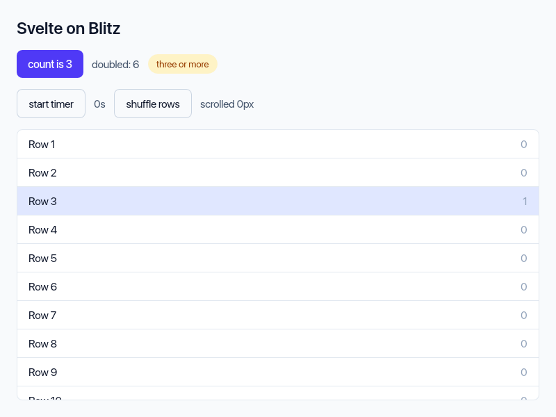

# svelte-blitz

Svelte apps in a native window, without a webview and without Node at runtime.

Svelte components are compiled with Svelte's custom renderer API. Instead of the
browser DOM they drive [Blitz](https://github.com/DioxusLabs/blitz), a Rust
HTML/CSS engine (Stylo for CSS, Taffy for layout, Parley for text, Vello for
painting). The JavaScript runs in an embedded QuickJS-ng. Styling is ordinary
CSS, so Tailwind works as it does on the web.

This is a starter covering the first three milestones: static render, events and
reactivity, Tailwind. It is small enough to read in one sitting (about 700 lines
of JS and 1,200 of Rust).



## Run it

Requires Node 22+, a recent stable Rust (built here with 1.97) and, on Linux, the usual windowing libraries
(`libxkbcommon`, X11 or Wayland dev packages, a Vulkan driver).

```sh
pnpm install
pnpm test              # type checks, JS renderer test, then the headless end-to-end tests
pnpm run check         # type checks only (tsc for the package, svelte-check for the examples)
pnpm run screenshot    # render the example to screenshot.png on the CPU
pnpm start             # open the example in a window
pnpm dev               # the same, reloading on every save
```

## Start a project

```sh
svelte-blitz create my-app      # TypeScript, Tailwind, an icon and a manifest
cd my-app
pnpm install
pnpm dev                        # opens the app, reloads on save
pnpm start                      # build once and open it
pnpm bundle                     # my-app.app
pnpm check                      # svelte-check
```

`create` copies the starter from `packages/renderer/template` and fills in the
project name. The `svelte-blitz` command comes with the package:

```
svelte-blitz create <directory>
svelte-blitz run [dist]
svelte-blitz bundle [dist] [out-dir] [--sign <identity>] [--notarize <keychain-profile>]
svelte-blitz screenshot <out.png> [dist] [WIDTHxHEIGHT]
```

### Where the host binary comes from

The main package is JavaScript only. The host ships in one small package per
platform, each holding a single file, and the main package lists them as
optional dependencies; the package manager installs the one whose `os` and
`cpu` match. Nobody who installs from npm needs Rust.

```
@ethercorps/svelte-blitz                 renderer, Vite preset, CLI, template (40 kB)
@ethercorps/svelte-blitz-darwin-arm64    svelte-blitz-host (22.8 MB, 9.9 MB packed)
```

`SVELTE_BLITZ_HOST` overrides the lookup with a host you built yourself.

Only macOS arm64 exists so far (`pnpm run build:host` builds it into
`packages/host-darwin-arm64`). Intel macOS, Linux and Windows need a CI build
each. **Nothing is published yet**, so today `create` is run from this
repository (`node packages/renderer/src/cli.js create ../my-app`) and the new
project installs the packages from tarballs made with `pnpm pack`.

## Dev: reload on save

`vite build --watch` is the dev command (`pnpm dev` in this repository builds
the host first and points `SVELTE_BLITZ_HOST` at it). The preset starts the
host after the first build and tells it to reload after each later one. The window stays open and keeps its size,
position and page scroll; the app itself starts over, so component state is
lost. This is a live reload, not Svelte HMR.

- A build error leaves the last good build on screen; so does a bundle that
  throws while it loads. Fix and save again.
- Closing the window ends Vite. Stopping Vite closes the window.
- Changes to `app.json` (title, size, icon) need a restart.
- On macOS the host runs out of a throwaway bundle in
  `node_modules/.svelte-blitz/`, so the Dock and the app switcher show the
  app's name and icon in dev too. This needs `app.name` in the manifest.
- There is no file watcher and no polling in the host: Vite writes one line to
  the host's stdin per rebuild. `svelte-blitz-host --watch dist` run by hand
  reloads when you press Enter.


An app describes itself through the Vite preset:

```ts
svelteBlitz({
	app: {
		name: 'Counter',
		icon: 'icon.png', // PNG, 1024×1024 recommended, relative to the Vite root
		window: { title: 'Svelte on Blitz', width: 800, height: 600 }
	}
})
```

The build writes `dist/app.json` and copies the icon to `dist/icon.png`. Point
the host at the directory and it picks them up: `svelte-blitz-host dist`.
Every field is optional; `svelte-blitz-host app.js app.css` still works and
runs without a manifest.

| Platform | Where the icon shows |
|---|---|
| macOS | Dock, set at runtime through AppKit. Leave a transparent margin around the artwork (an 824px tile on the 1024px canvas) or it looks larger than its neighbours. |
| Windows, X11 | Window icon through winit. Not run yet. |
| Wayland | Nothing at runtime: compositors take the icon from a `.desktop` file. Not done yet. |

A missing or undecodable icon stops the app with an error naming the file.

On macOS `name` also becomes the process name, which is what the menu bar
items ("Quit Counter") use. Run straight from the host binary, the Dock label,
the app switcher and Activity Monitor still say `svelte-blitz-host`: macOS takes
those from an app bundle. Build one to get them right.

## Bundle a macOS app

```sh
pnpm run bundle        # examples/counter/bundle/Counter.app
svelte-blitz-host --bundle dist [out-dir]
```

```
Counter.app/Contents/
  Info.plist           name, id, version, icon
  MacOS/Counter        the host binary that did the bundling
  Resources/           everything from dist/, plus AppIcon.icns
```

The manifest needs a `name`. `id` (default `app.svelte-blitz.<name>`) and
`version` (default `0.1.0`) should be set for anything you ship. The icon must
be square; the `.icns` is generated from it at every size up to its own.
Double-clicking the app runs the host with no arguments, and it loads the app
from `Resources`.

- Without `--sign` the bundle is ad-hoc signed, which is enough to run it on
  the Mac that built it.
- It replaces a previous bundle of the same name, and refuses to touch an
  `.app` it did not build.
- Use a release build of the host (`pnpm run bundle` does). The binary is about
  25 MB today.
- macOS only. There is no Windows or Linux packaging yet.

### Signing for other Macs

A downloaded app only opens without warnings if it is signed with a Developer
ID certificate and notarised by Apple.

```sh
# once: store an app-specific password in the keychain under a profile name
xcrun notarytool store-credentials my-profile --apple-id you@example.com --team-id TEAMID

svelte-blitz bundle dist --sign "Developer ID Application: Your Name (TEAMID)" --notarize my-profile
```

`--sign` signs with the hardened runtime and a secure timestamp; the host
needs no entitlements. `--notarize` zips the app, submits it with `notarytool`,
waits for the result and staples the ticket to the bundle. `--sign` alone has
been run here with a real Developer ID and the result launches; Gatekeeper
then reports "Unnotarized Developer ID" until it is notarised. **`--notarize`
has not been run**: it uploads to Apple and needs your credentials.

## Icons and images


Icons are ordinary Svelte: inline `<svg>`, or a component library. They take
their colour from `currentColor` and their size from props or classes, so
Tailwind works on them directly.

```svelte
<script lang="ts">
	import { Heart, Settings } from '@lucide/svelte';
</script>

<span class="text-rose-600"><Heart /></span>
<Settings class="size-8 text-slate-500" strokeWidth={1.5} />
<svg class="size-6 text-indigo-600" viewBox="0 0 24 24" fill="currentColor">…</svg>
```

Colours follow later changes too: switch a class on a parent and the icons
inside repaint.

Images load from two places and nowhere else:

```svelte
<script lang="ts">
	import logo from './logo.svg'; // Vite inlines it as a data: URL
</script>


   <!-- a file next to app.js: put it in public/ -->
```

- `data:` URLs, which is what an `import` of an asset becomes.
- Files inside the app directory (`dist`, or `Resources` in a bundle). A path
  that leaves it, through `..` or a symlink, is refused.
- There is no network: `http(s):` URLs do not load. A URL that cannot be
  loaded is reported on stderr and the image stays empty.

CSS `url()` and `@font-face` go through the same loader but have not been
tried yet.

## TypeScript

The examples are TypeScript: `src/main.ts`, `<script lang="ts">` and
`vite.config.ts`, checked with `svelte-check`. The preset picks up `src/main.ts`
or `src/main.js`, whichever exists. Plain JavaScript apps work unchanged.

The package ships declarations for `mount`, `unmount` and the Vite preset.
Its source stays JavaScript with JSDoc; `tsc` checks it and generates
`packages/renderer/types/` on `pnpm install`.

- Svelte strips type annotations itself. TypeScript features that emit code
  (`enum`, parameter properties) in a `.svelte` file need `vitePreprocess`,
  passed as `svelteBlitz({ svelte: { preprocess: vitePreprocess() } })`.
- An app's `tsconfig.json` includes the `dom` lib because Svelte's element and
  event types need it. That means `window`, `document` and `fetch` type-check
  but do not exist at runtime.
- TypeScript is held at 6.x: `svelte-check` 4.7 does not accept TypeScript 7.

## Layout

```
packages/renderer/        the `@ethercorps/svelte-blitz` npm package
  src/cli.js              the `svelte-blitz` command
  src/host.js             finds the host binary
  template/               what `svelte-blitz create` copies
packages/host-darwin-arm64/   npm package for the host binary (binary not committed)
scripts/build-host-package.js builds the host and fills this platform's package
  src/renderer.js         createRenderer(): node mirror, op buffer, event bubbling
  src/shims.js            console, timers, queueMicrotask for a bare engine
  src/index.js            mount() and the host's entry points (globalThis.__sb)
  src/protocol.js         opcodes shared with the host
  src/vite.js             Vite preset: one app.js (IIFE) + one app.css
  types/                  generated .d.ts (not committed)
  test/                   a host written in JS, for testing without Rust
crates/host/              the `svelte-blitz-host` crate
  src/js.rs               QuickJS embedding
  src/ops.rs              applies op batches to blitz-dom
  src/app.rs              app directory, app.json manifest, icon decoding
  src/bundle.rs           macOS .app bundle: Info.plist, .icns
  src/document.rs         SvelteDocument: implements blitz_dom::Document
  src/net.rs              loads data: URLs and files from the app directory
  src/timers.rs           wakes the event loop for JS timers
  src/window.rs           window + GPU renderer (blitz-shell, Vello Hybrid)
  src/screenshot.rs       CPU rendering to PNG, no display needed
  src/testing.rs          query(), click(), text() for headless tests
  tests/counter.rs        end-to-end tests against the example bundle
  tests/manifest.rs       manifest parsing and icon decoding
  tests/bundle.rs         bundle layout, Info.plist, .icns contents
  tests/icons.rs          icon and image pixels, resource loading
crates/blitz-dom/         blitz-dom 0.3.0-beta.4 with two fixes (see PATCH.md)
examples/counter/         Svelte 5 + Tailwind 4 + TypeScript example
```

## How it works

```
 Svelte runtime ── renderer.js ──► op buffer ──┐            (JavaScript, QuickJS)
        ▲                                      │ one batch per turn
        │ dispatch(target, type, detail)       ▼
 SvelteDocument ◄── Blitz event driver    apply_batch ──► blitz-dom ──► paint
                                                             (Rust)
```

**Writes are batched.** Svelte calls `createElement`, `insert`, `setText` and so
on. None of those calls leave JS: each appends a few integers to an array. At
the end of a turn the host calls `__sb.take()` once and applies the whole batch
through a single `DocumentMutator`, so Blitz restyles and relayouts once.
Mounting the example (1,000 rows, about 6,000 nodes) is one batch; a counter
click is a batch of 2 ops.

**Reads never cross the boundary.** Svelte walks the tree synchronously
(`getFirstChild`, `getNextSibling`, `getParent`), so each node has a small JS
object with parent and sibling pointers. Unlike a shadow tree that is re-projected
every frame, this mirror is only touched when Svelte touches it.

**Node ids are allocated in JS.** Creating a node needs no return value from the
host, which is what lets creation be batched too.

**Events.** Blitz hit-tests and runs its event driver. For each DOM event the
host checks a set of event types that have listeners; if nobody listens (mouse
moves, typically) JS is not entered at all. Otherwise it calls `__sb.dispatch`
once and the renderer bubbles the event through its own tree, because Svelte
does not delegate or bubble for custom renderers. Handlers run synchronously
inside Blitz's dispatch, so `preventDefault()` works; that is safe because
handlers only write to the op buffer.

**No frame loop.** The event loop waits in the OS. JS timers live in JS; the
host reads the next deadline at the end of each turn and a small thread wakes
the loop when it is due. With no timer pending and no input, nothing runs.

**Memory.** When Svelte drops a subtree, the JS node objects become garbage.
A `FinalizationRegistry` turns that into `DROP` ops and the host frees the Blitz
nodes.

## What was verified, and what was not

Checked on Linux x86-64, in a sandbox with no display:

| | |
|---|---|
| Renderer against Svelte 5.59.1 in an engine with no DOM globals | `pnpm run test:js` |
| Real bundle → QuickJS → blitz-dom 0.3.0-beta.4 → style and layout | `tests/counter.rs` |
| Tailwind 4.3 stylesheet (incl. `oklch()` colours, `@layer`) lays out and paints correctly | layout assertions + `screenshot.png` |
| Clicks through Blitz hit testing, bubbling, `{#if}`, keyed `{#each}` reorder | `counter_app` |
| Inline SVG and Lucide icons in hex and Tailwind colours, recolouring after a click, `` from a data: URL, a file and an import | `tests/icons.rs` (pixels) + `docs/icons-probe.png` |
| Resources: only data: URLs and files inside the app directory load; bad URLs do not crash | `tests/icons.rs` |
| Idle turns do nothing; unused event types never enter JS | `idle_turns_do_no_work` |
| Timer wake-ups, and silence when no timer is running | `timers_wake_the_event_loop` |
| Removed nodes are freed on the host after GC | `removed_nodes_are_freed` |

Numbers from the dev-profile build on 2 shared cores, so treat them as
rough: mount of 6,000 nodes about 290 ms (most of it QuickJS running Svelte),
first style and layout 47 ms, click to updated layout 2 ms.

Checked on macOS 27 (Apple M4 Pro, arm64, rustc 1.95):

| | |
|---|---|
| Everything in the table above | `pnpm test` |
| CPU screenshot with macOS system fonts | `--screenshot`, inspected by eye |
| The window opens (Vello Hybrid), 800×600 logical, no errors or panics | `pnpm start` |
| Idle with the timer stopped: 0.0% CPU, 0 idle wake-ups over 8 s, 84 MB | `top -stats cpu,idlew,mem` |
| Manifest → host: title, size and icon parsed; bad icons are errors, not panics | `tests/manifest.rs` |
| The window opens at the size the manifest asks for | window bounds from WindowServer |
| Bundle: `plutil` and `iconutil` accept the plist and `.icns`, `codesign --verify --strict` passes, the app launches from `open`, macOS reports the name "Counter" and shows the icon for the bundle | `pnpm run bundle`, macOS tools |
| A fresh project installed from the two tarballs, no `SVELTE_BLITZ_HOST`: type-check, build, render, bundle, dev reload | `pnpm run test:template`, plus bundle and dev by hand |
| Dev runs from a bundle: macOS reports the name "Counter" and its bundle id | `pnpm dev`, `lsappinfo` |
| Developer ID signing: `codesign --verify --strict` passes, hardened runtime flag set, the app launches | `--sign` with a real identity |
| Dev reload: edit → reload in ~130 ms, broken builds keep the old one, Vite and host stop together | `pnpm dev`, read from the host log |

**Not verified:**

- **What the window shows and how it reacts.** On macOS it opens and idles
  correctly, but painting, clicks, wheel scrolling, hover styles, resizing and
  CPU with the timer running have not been confirmed by eye yet.
- **The Dock icon and window title on macOS.** The code runs without errors,
  but nobody has looked at the Dock yet.
- Windows builds, and the window on Linux. That includes the window icon on
  Windows and X11.
- Text input, IME, focus and keyboard events. The event payloads are wired
  (`key`, `code`, `value`) but no test types into a field.

## Limitations

- `bind:`, `transition:`, `animate:`, `<svelte:window>`, `<svelte:head>` are
  rejected by Svelte for custom renderers. Use `value={x}` + `oninput`.
- No `fetch`, storage, or file APIs in JavaScript yet. Each needs a host function in `js.rs`.
- Images and other resources load from data: URLs and the app directory only; no network.
- `requestAnimationFrame` is a 16 ms timer, not tied to the display.
- Capture-phase listeners are treated as bubble-phase.
- An element is put in the SVG namespace by its name alone. `a`, `title`,
  `style` and `script` are always HTML, also inside an `<svg>`.
- Blitz itself is beta. Its status page lists `position: sticky`, container
  queries, 3D transforms and `overflow: auto` as missing; `backdrop-filter`
  needs its Skia backend.
- One window. Packaging for macOS only; notarisation is implemented but has never been run. Dev reload resets state (no HMR).
- The Svelte custom renderer API shipped in 5.59.0 and is days old. Blitz and
  the renderer crates are pinned to exact versions for the same reason.

## Next steps

1. Run `pnpm start` on a machine with a display and fix whatever the window turns up.
2. Text input: a controlled `<input>` test, then IME.
3. Host modules: `fetch`, clipboard, window controls.
4. State-preserving HMR, if the full reload turns out not to be enough.
5. A virtual list component, then packaging per OS.
6. Try compiling the bundle with scriptc and replacing QuickJS. Only `js.rs`
   should need to change; the protocol is engine-agnostic.

## Licence

MIT, see `LICENSE`.

The host binary statically links Stylo and its companion crates (the CSS
engine), which are MPL-2.0. That does not change the licence of this code, but
a distributed binary has to say so and point at their source; a third-party
licence file generated at release time is still to be added.
