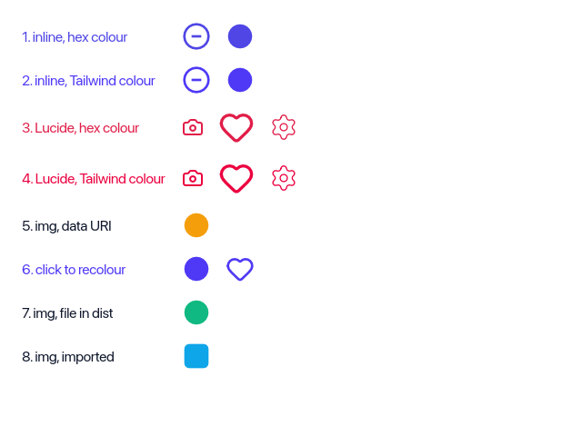

<p align="center"></p>

# svelte-blitz

Svelte apps in a native window, without a webview and without Node at runtime.

Svelte components are compiled with Svelte's custom renderer API. Instead of the
browser DOM they drive [Blitz](https://github.com/DioxusLabs/blitz), a Rust
HTML/CSS engine (Stylo for CSS, Taffy for layout, Parley for text, Vello for
painting). The JavaScript runs in an embedded QuickJS-ng. Styling is ordinary
CSS, so Tailwind works as it does on the web.

This is a starter covering the first three milestones: static render, events and
reactivity, Tailwind. It is small enough to read in one sitting (about 700 lines
of JS and 1,200 of Rust).


## Run it

Requires Node 22+, a recent stable Rust (built here with 1.97) and, on Linux, the usual windowing libraries
(`libxkbcommon`, X11 or Wayland dev packages, a Vulkan driver).

```sh
pnpm install
pnpm test              # type checks, JS renderer test, then the headless end-to-end tests
pnpm run check         # type checks only (tsc for the package, svelte-check for the examples)
pnpm run screenshot    # render the example to screenshot.png on the CPU
pnpm start             # open the example in a window
pnpm dev               # the same, reloading on every save
```

## Start a project

```sh
pnpm create @ethercorps/svelte-blitz my-app   # TypeScript, Tailwind, file-based routes, icon, manifest, static/
cd my-app
pnpm install
pnpm dev                        # opens the app, reloads on save
pnpm start                      # build once and open it
pnpm bundle                     # my-app.app
pnpm check                      # svelte-check
```

**Nothing is published yet.** Until it is, create a project from this
repository with `node packages/create/index.js ../my-app` and install the
packages from tarballs made with `pnpm pack`; `packages/create/template.test.js`
does exactly that.

## Packages

| Package | What it is | Directory |
|---|---|---|
| `@ethercorps/svelte-blitz` | The runtime: `mount`, the renderer, the op protocol. No Node code. | `packages/core` |
| `@ethercorps/svelte-blitz-vite` | The Vite preset (build, app manifest, `static/`, dev reload) and the file-based router. | `packages/vite` |
| `@ethercorps/svelte-blitz-cli` | The `svelte-blitz` command. | `packages/cli` |
| `@ethercorps/create-svelte-blitz` | The starter template. | `packages/create` |
| `@ethercorps/svelte-blitz-host` | The host binaries, and the lookup that picks one. | `packages/host` |

They are released together under one version (`pnpm run check` fails if they
drift). An app depends on the first, and has the Vite preset and the CLI as
dev dependencies.

```
svelte-blitz run [dist]
svelte-blitz bundle [dist] [out-dir] [--sign <identity>] [--notarize <keychain-profile>]
svelte-blitz screenshot <out.png> [dist] [WIDTHxHEIGHT]
```

### Where the host binary comes from

One package, `@ethercorps/svelte-blitz-host`, holds the binary for every
platform under `bin/<platform>/`, so nobody who installs from npm needs Rust.
The Vite preset and the CLI ask that package for the path;
`SVELTE_BLITZ_HOST` overrides it with a host you built yourself.

Only macOS arm64 exists so far: 22.8 MB, about 10 MB packed
(`pnpm run build:host` builds it into `packages/host/bin/darwin-arm64`). Intel
macOS, Linux and Windows need a CI build each, and every one adds roughly that
much to what every user downloads. If that grows uncomfortable, the package
can switch to fetching only the matching binary on first use; nothing outside
it would change.

## Dev: reload on save

`vite build --watch` is the dev command (`pnpm dev` in this repository builds
the host first and points `SVELTE_BLITZ_HOST` at it). The preset starts the
host after the first build and tells it to reload after each later one. The window stays open and keeps its size,
position and page scroll; the app itself starts over, so component state is
lost. This is a live reload, not Svelte HMR.

- A build error leaves the last good build on screen; so does a bundle that
  throws while it loads. Fix and save again.
- Closing the window ends Vite. Stopping Vite closes the window.
- Changes to `app.json` (title, size, icon) need a restart.
- On macOS the host runs out of a throwaway bundle in
  `node_modules/.svelte-blitz/`, so the Dock and the app switcher show the
  app's name and icon in dev too. This needs `app.name` in the manifest.
- There is no file watcher and no polling in the host: Vite writes one line to
  the host's stdin per rebuild. `svelte-blitz-host --watch dist` run by hand
  reloads when you press Enter.


## App config

An app describes itself in `app.config.ts`, next to `vite.config.ts`:

```ts
import { defineConfig } from '@ethercorps/svelte-blitz-vite';

export default defineConfig({
	app: {
		name: 'Counter',
		id: 'com.example.counter',
		// icon: static/icon.png is used when it exists (PNG, square, 1024×1024 recommended)
		window: { title: 'Svelte on Blitz', width: 800, height: 600 }
		// version: defaults to the one in package.json
		// updater: see "Updates"
	},
	permissions: {
		// what the app may do outside its window; see "Desktop APIs"
	}
	// router: see "Your own router"
	// dom: true, for component libraries written for the web; see "Component libraries"
});
```

That leaves `vite.config.ts` as a list of plugins:

```ts
export default defineConfig({
	plugins: [tailwindcss(), svelteBlitz()]
});
```

The file can also be `.js` or `.mjs`, and can export a function, which gets
Vite's `{ mode, command }`. Anything passed to `svelteBlitz({ … })` directly
overrides the file, key by key. In watch mode, edits to `app` and
`permissions` are picked up on the next build; a change to `router` needs
Vite restarted.

The icon is a static file: put it in `static/` and it is copied with the
rest. `app.icon` names another file there if it is not called `icon.png`.

The build writes `dist/app.json`. Point
the host at the directory and it picks them up: `svelte-blitz-host dist`.
Every field is optional; `svelte-blitz-host app.js app.css` still works and
runs without a manifest.

| Platform | Where the icon shows |
|---|---|
| macOS | Dock, set at runtime through AppKit. Leave a transparent margin around the artwork (an 824px tile on the 1024px canvas) or it looks larger than its neighbours. |
| Windows, X11 | Window icon through winit. Not run yet. |
| Wayland | Nothing at runtime: compositors take the icon from a `.desktop` file. Not done yet. |

A missing or undecodable icon stops the app with an error naming the file.

On macOS `name` also becomes the process name, which is what the menu bar
items ("Quit Counter") use. Run straight from the host binary, the Dock label,
the app switcher and Activity Monitor still say `svelte-blitz-host`: macOS takes
those from an app bundle. Build one to get them right.

## Bundle a macOS app

```sh
pnpm run bundle        # examples/counter/bundle/Counter.app
svelte-blitz-host --bundle dist [out-dir]
```

```
Counter.app/Contents/
  Info.plist           name, id, version, icon
  MacOS/Counter        the host binary that did the bundling
  Resources/           everything from dist/, plus AppIcon.icns
```

The manifest needs a `name`. `id` (default `app.svelte-blitz.<name>`) and
`version` (default `0.1.0`) should be set for anything you ship. The icon must
be square; the `.icns` is generated from it at every size up to its own.
Double-clicking the app runs the host with no arguments, and it loads the app
from `Resources`.

- Without `--sign` the bundle is ad-hoc signed, which is enough to run it on
  the Mac that built it.
- It replaces a previous bundle of the same name, and refuses to touch an
  `.app` it did not build.
- Use a release build of the host (`pnpm run bundle` does). The binary is about
  25 MB today.
- macOS only. There is no Windows or Linux packaging yet.

### Signing for other Macs

A downloaded app only opens without warnings if it is signed with a Developer
ID certificate and notarised by Apple.

```sh
# once: store an app-specific password in the keychain under a profile name
xcrun notarytool store-credentials my-profile --apple-id you@example.com --team-id TEAMID

svelte-blitz bundle dist --sign "Developer ID Application: Your Name (TEAMID)" --notarize my-profile
```

`--sign` signs with the hardened runtime and a secure timestamp; the host
needs no entitlements. `--notarize` zips the app, submits it with `notarytool`,
waits for the result and staples the ticket to the bundle. `--sign` alone has
been run here with a real Developer ID and the result launches; Gatekeeper
then reports "Unnotarized Developer ID" until it is notarised. **`--notarize`
has not been run**: it uploads to Apple and needs your credentials.

## Routing

Pages are files in `src/routes`, with SvelteKit's conventions. A project that
has that directory needs no `main.ts`: the router is the entry.

```
src/routes/
  +layout.svelte            wraps every page; stays mounted while pages change
  +layout.ts                load() for the layout
  +page.svelte              /
  +error.svelte             shown for errors and unknown paths
  about/+page.svelte        /about
  items/+page.svelte        /items
  items/[id]/+page.svelte   /items/42          params.id === '42'
  items/[id]/+page.ts       load() for that page
  docs/[...path]/+page.svelte   /docs/a/b      params.path === 'a/b'
  (account)/+layout.svelte  a group: a layout without a path segment
  (account)/settings/+page.svelte   /settings
```

```ts
// src/routes/items/[id]/+page.ts
import { error } from '@ethercorps/svelte-blitz-vite/router';
import { items } from '$lib/items';

export async function load({ params, parent }) {
	const item = items.find((item) => item.id === params.id);
	if (!item) error(404, `No item ${params.id}`);
	return { item, ...(await parent()) };
}
```

```svelte
<!-- src/routes/items/[id]/+page.svelte -->
<script lang="ts">
	import { goto } from '$app/navigation';
	import { page } from '$app/state';

	let { data, params } = $props();
</script>

<h1>{data.item.name}</h1>
<a href="/items">all items</a>
<button onclick={() => goto('/')}>home</button>
<p>{page.url.pathname}</p>
```

What works as in SvelteKit:

- `+page.svelte`, `+layout.svelte` (nested, with `{@render children()}`),
  `+error.svelte`, `[param]`, `[...rest]`, `(group)`.
- `load` in `+page.js`/`.ts` and `+layout.js`/`.ts`, sync or async, with
  `params`, `url`, `route` and `parent()`. The result arrives as the `data`
  prop, merged with the layouts' data. The old page stays up until the new
  one's loads are done.
- `<a href="/path">` navigates. `goto()` from `$app/navigation`, `page` from
  `$app/state`, and the `$lib` alias.
- `error(status, message)` and `redirect(status, location)` inside `load`,
  imported from `@ethercorps/svelte-blitz-vite/router`.

What is different, because there is no browser and no server:

- **The location lives in memory.** There is no address bar and no History
  API. `back()` and `forward()` come from `$app/navigation` instead of
  `history`.
- **`page.url` is a plain object** with `pathname`, `search`, `hash`, `href`
  and `searchParams.get()/has()`. The engine has no `URL` class.
- **No server files.** `+page.server.*`, `+layout.server.*` and `+server.*`
  are build errors. So are optional parameters (`[[x]]`) and matchers
  (`[x=m]`).
- **No generated `./$types`.** Type `data` and `params` yourself.
- **Every `load` runs on every navigation**; there is no `invalidate`, and no
  `beforeNavigate`/`afterNavigate`.
- **All pages are in one bundle.** There is no code splitting.

`examples/routing` exercises all of it.

### Your own router

The built-in router is the default, not a requirement. The preset's `router`
option replaces it or turns it off:

```ts
svelteBlitz({ router: false })                          // no routing; src/main.ts is the entry
svelteBlitz({ router: { entry: 'src/my-router.ts' } })  // your router is the entry
svelteBlitz({ router: { dir: 'src/pages' } })           // built-in router, other directory
```

A router of your own is a module that mounts the app. It can use the route
table the preset generates from the routes directory, or ignore it:

```ts
// src/my-router.ts
import { mount } from '@ethercorps/svelte-blitz';
import { routes, fallback } from 'virtual:svelte-blitz/routes';
import Shell from './Shell.svelte';

// Each route: { id, pattern, names, layouts, page, error, error_depth }.
// `page` and each layout are { component, load }.
mount(Shell, { props: { routes, fallback } });
```

With a custom entry the built-in `$app/navigation` and `$app/state` are not
set up; your router exports its own API. The `Route` and `RouteNode` types
come from `@ethercorps/svelte-blitz-vite/router`.

Running SvelteKit itself on this renderer is not practical. Its client
router (3,800 lines in 3.0.1) is written against `location`, `history`,
`document`, `fetch` and dynamic `import()`, mounts its root without a
renderer option, and its build expects a server pass.

## Component libraries: shadcn-svelte

Tested with shadcn-svelte 1.8 (its CLI, the `vega` preset, 16 components).

**The styling system works completely**: the Tailwind v4 theme, its `oklch()`
variables, variants (`tailwind-variants`), Lucide icons and the Inter font all
render as on the web.

| Works | Works with `dom: true` | Does not work yet |
|---|---|---|
| Button, Badge, Card, Alert, Skeleton, Separator, Progress, Label, Input (displaying a value) | Switch, Checkbox, Tabs, Accordion, Dialog, Select, Tooltip, with mouse and keyboard, opening and closing animated | Other Bits UI components: not tried |

The first column is markup and classes. Everything else is built on Bits UI,
which is written for a browser: it reads `window` and `document`, listens on
them, creates elements, moves focus and measures boxes.

### `dom: true`

```ts
// app.config.ts
export default defineConfig({ dom: true });
```

This builds the app as a browser bundle (the `browser` export condition) and
loads `@ethercorps/svelte-blitz/dom` before anything else. That module puts a
small DOM on top of the renderer's own tree: `window`, `document`, selectors
(`querySelector`, `matches`, `closest`), attributes, `classList`, `style`,
`dataset`, tree edits, `Event` and its subclasses, `EventTarget`,
`AbortController`, listeners on `document` and `window`, focus tracking. Every
write goes through the same op buffer as Svelte's, so nothing about how the
host works changes. It is opt-in: an app that does not ask for it gets none of
it, and the rule that the bundle runs on ECMAScript built-ins alone still
holds for the layer itself.

### Measuring the page

Layout happens in the host. A measurement reaches JavaScript in two ways.

**Asked.** `getBoundingClientRect()`, `offsetWidth` and the like call
`__sb_host.measure(id)`, which is a forced layout, as in a browser: the host
applies what the app has written so far, lays the page out and returns the
node's box. Code that changes the page and measures it on the next line
depends on that. An Accordion slides open because Bits UI turns its animation
off, measures the content's full height, and turns it back on, all in one go.
This is the one place where JavaScript reads from the host.

**Told.** The first time a node is measured it is also marked with one op,
`MEASURE`. After each layout the host sends the app the window's size and the
box of every marked node that moved or changed size. `ResizeObserver` and the
`resize` event run on that, at the end of the turn, before the frame is
drawn, and again while the app keeps changing the page in answer (up to 8
times). That is how a Select's list is under its trigger in the first frame
it is visible in.

Inside an event handler the host cannot lay out, because Blitz is in the
middle of the document. A measurement made there is answered from the last
report: correct unless the handler itself changed the page first.

Not there:

- Boxes do not include CSS transforms (a dialog centred with `translate`
  reports where it would be without it).
- `getComputedStyle()` returns an empty style. Floating UI copes: it treats
  everything as unclipped and positions against the window.
- `element.getAnimations()` returns one object for everything animating on
  the element, finished when the last animation or transition is. That is what
  Bits UI waits on before it removes something, so an Accordion slides shut
  and a Dialog fades out. It is not the Web Animations API: nothing can be
  paused, sped up or read. There are no `animationend` events.
- Reopening an Accordion within 0.2 s of closing it can measure a height that
  is part-way through the animation Blitz is still running on it.
- Scrolling is not reported as `scroll` events, so a popup does not follow
  its anchor while the page scrolls under it.
A page that shows a `Skeleton` never goes idle: its pulse is an animation
that does not end, and Blitz redraws while one is running.

Some things had to be fixed underneath to get this far, and they apply to
any app:

- QuickJS answers `Object.getOwnPropertyDescriptor(proxy, key)` with a data
  descriptor even when the proxy's trap returned a getter and setter. Svelte
  asks that to find the setter of a bound prop that passes through
  `{...rest}` props, so `bind:` stopped at the first wrapper component.
  `shims.js` works around it.
- Blitz hit-tested a box in a line of text (a `<button>` that is not a flex
  or grid item) as if it were shifted by its container's padding. Fixed in
  the patched `blitz-dom`.
- Capture-phase listeners now run in the capture phase.
- An event that hits nothing the app made (the page around `<body>`, or a
  `<body>` with `pointer-events: none`) used to be dropped. With the DOM
  layer it goes to `document` with `<html>` as its target, as in a browser.

### Keyboard

Works, with or without `dom: true`: Tab and Shift+Tab move the focus, Enter
and Space press the focused button, link or checkbox, typing and the editing
keys change a text input (`bind:value` follows), and `keydown`/`keyup` reach
the app with `key`, `code` and the modifier flags. A focus ring styled with
`:focus-visible` shows for keyboard focus and not after a click.

With `dom: true`, `element.focus()` and `blur()` move the real focus, and
`document.activeElement` follows whoever moved it. That is what Bits UI needs:
a Select takes arrow keys, Enter and Escape, a Dialog moves the focus into
itself, keeps Tab inside, closes on Escape and gives the focus back.

Not there: IME, `:focus-within`, and a focus ring that knows whether a
`focus()` call followed a click (it always shows). Clipboard shortcuts in a
text field exist in Blitz but have not been tried.

Out of the box none of it compiled, because every shadcn component has
`bind:this={ref}` on its root element and Svelte refuses that for custom
renderers. The preset rewrites element bindings before Svelte sees them
(`packages/vite/src/bindings.js`), which applies to any component library.

`examples/shadcn` is a page of the working components. `node probe.mjs` in
that directory compiles and runs each file in `src/probes` and reports
whether it loads; `cargo run --features screenshot --example drive` (in
`crates/host`) clicks through a built app and prints what happened.

## Icons and images



Icons are ordinary Svelte: inline `<svg>`, or a component library. They take
their colour from `currentColor` and their size from props or classes, so
Tailwind works on them directly.

```svelte
<script lang="ts">
	import { Heart, Settings } from '@lucide/svelte';
</script>

<span class="text-rose-600"><Heart /></span>
<Settings class="size-8 text-slate-500" strokeWidth={1.5} />
<svg class="size-6 text-indigo-600" viewBox="0 0 24 24" fill="currentColor">…</svg>
```

Colours follow later changes too: switch a class on a parent and the icons
inside repaint.

Images load from two places and nowhere else:

```svelte
<script lang="ts">
	import logo from './logo.svg'; // Vite inlines it as a data: URL
</script>


   <!-- a file next to app.js: put it in static/ -->
```

- `data:` URLs, which is what an `import` of an asset becomes.
- Files inside the app directory (`dist`, or `Resources` in a bundle).
  Everything in the project's `static/` directory is copied there by the
  build, as it is. A path that leaves the app directory, through `..` or a
  symlink, is refused.
- Resources never come from the network: `http(s):` URLs do not load. A URL
  that cannot be loaded is reported on stderr and the image stays empty.

CSS `url()` and `@font-face` go through the same loader but have not been
tried yet.

## Updates

A bundled app can update itself, in the way Tauri's updater works: it reads a
small feed, downloads the new version, checks its signature against a key
built into the app, replaces itself and restarts.

**1. Make a key pair, once.**

```sh
svelte-blitz signer generate ~/.keys/my-app.key
# prints the public key
```

The file is the private key. Keep it secret and backed up: updates signed
with any other key are refused by every copy of the app already installed.

**2. Tell the app where updates come from**, in `app.config.ts`.

```ts
export default defineConfig({
	app: {
		name: 'My App',
		version: '1.0.0',
		updater: {
			url: 'https://github.com/you/my-app/releases/latest/download/latest.json',
			pubkey: '…the public key…'
		}
	}
});
```

**3. Offer the update in the app.**

```svelte
<script lang="ts">
	import { check } from '@ethercorps/svelte-blitz/updater';

	async function update() {
		const found = await check();        // null when up to date
		if (!found) return;
		console.log(found.version, found.notes);
		await found.download();             // fetched and verified; nothing replaced yet
		await found.install();              // replaces the app and starts the new version
	}
</script>
```

**4. Release a new version.** Raise `version`, build, and bundle with the key:

```sh
vite build
svelte-blitz bundle --sign "Developer ID Application: …" --notarize my-profile \
  --update-key ~/.keys/my-app.key --update-notes "What changed"
```

Next to the `.app` this writes three files. Upload them to the place the feed
URL points at:

```
My App-1.1.0-darwin-arm64.app.tar.gz        the update
My App-1.1.0-darwin-arm64.app.tar.gz.sig    its signature
latest.json                                 the feed
```

In CI, `SVELTE_BLITZ_UPDATER_KEY` can hold the private key instead of
`--update-key`.

What it guarantees:

- An update is installed only if its signature matches the key in the running
  app. A changed archive, or one signed by someone else, is refused and the
  app stays as it is.
- The app never moves to the same or an older version.
- The feed and the archive are fetched over HTTPS only (plain HTTP is accepted
  for `127.0.0.1`, for local testing).
- Bundling refuses a signing key that does not match `updater.pubkey`.

What it does not do yet:

- **Installing is macOS only.** `check()` and `download()` work everywhere;
  `install()` replaces a `.app` bundle.
- **No download progress**, and no partial or delta updates: the whole app is
  downloaded.
- **`install()` rejects in dev** and whenever the app is not running from a
  bundle, or cannot write to where it is installed.
- **A feed for several platforms** is merged when builds of the same version
  write into the same directory; across CI machines you merge the
  `platforms` entries yourself.

`examples/updater` has the full flow with a small UI, and
`scripts/updater-e2e.sh` runs a real update on a Mac: an installed 0.1.0
finds 0.2.0 on a local server, replaces itself and relaunches.

The updater talks to the feed URL and the archive it names, and nothing else.

## Desktop APIs

An app reaches outside its window through the APIs below. All of them are
**off until `permissions` in `app.config.ts` allows them**, and the
host enforces that, not JavaScript. A refused call rejects with a message
naming the entry to add.

```ts
permissions: {
	http: ['https://api.example.com'],   // which servers fetch() may talk to
	fs: ['data', 'downloads'],           // which directories the file APIs may use
	dialog: true,
	clipboard: true,
	open: true,
	window: true
}
```

| API | Import | Permission |
|---|---|---|
| `fetch(url, { method, headers, body })` | a global, nothing to import | `http` |
| `readTextFile`, `writeTextFile`, `readFile`, `writeFile`, `exists`, `mkdir`, `readDir`, `remove`, `dir` | `@ethercorps/svelte-blitz/fs` | `fs` |
| `open`, `save`, `message`, `confirm` | `@ethercorps/svelte-blitz/dialog` | `dialog` |
| `readText`, `writeText` | `@ethercorps/svelte-blitz/clipboard` | `clipboard` |
| `open(linkOrPath)` | `@ethercorps/svelte-blitz/shell` | `open` |
| `setTitle`, `minimize`, `maximize`, `unmaximize`, `isMaximized`, `setDecorations`, `startDragging`, `close` | `@ethercorps/svelte-blitz/window` | `window` |

```ts
import { writeTextFile, readTextFile } from '@ethercorps/svelte-blitz/fs';
import { open } from '@ethercorps/svelte-blitz/dialog';

// The app's own data directory; created on first write.
await writeTextFile('settings.json', JSON.stringify(settings), { dir: 'data' });

const response = await fetch('https://api.example.com/items');
const items = await response.json();

// A file the user picks may be read without being listed in permissions.fs.
const path = await open({ filters: [{ name: 'Text', extensions: ['txt', 'md'] }] });
if (path) console.log(await readTextFile(path));
```

How the permissions work:

- **`http`** entries are origins, optionally with a path prefix
  (`https://example.com/api/`) or a wildcard host (`https://*.example.com`).
  `true` allows any. Redirects are followed, and every hop is checked.
- **`fs`** entries are directory names (`data`, `documents`, `downloads`,
  `desktop`, `home`) or absolute paths; `true` allows any path. `..` and
  symlinks cannot lead out of an allowed directory. A path is absolute, or
  relative to a named directory given as `{ dir }`.
- **`open`** opens `http:`, `https:` and `mailto:` links, and files the app may
  read. Every other kind of link is refused.

What to know:

- **`fetch` is the everyday part of the Fetch API**: method, headers, a string
  or byte body, and `text()`, `json()`, `arrayBuffer()`, `bytes()`. No
  streaming, no `AbortSignal`, no `Request`/`Headers`/`FormData` classes.
- **Calls made while the app starts** wait until the window exists.
- **A message or confirm dialog blocks the app** until it is answered.
- **Not run here:** writing to the real clipboard and opening a link in the
  browser (both would have acted on this machine while I worked), and reading
  the clipboard in a real window. `setTitle`, `setDecorations`,
  `startDragging` and `close` are wired to the window but were not observed.
- **Missing:** notifications, menus, tray, global shortcuts, multiple windows,
  window size and position, running other programs, a settings store.

`examples/desktop` has a button for each.

## TypeScript

The examples are TypeScript: `src/main.ts`, `<script lang="ts">` and
`vite.config.ts`, checked with `svelte-check`. The preset picks up `src/main.ts`
or `src/main.js`, whichever exists. Plain JavaScript apps work unchanged.

The packages ship declarations for `mount`, `unmount`, the Vite preset and
the router. Their source stays JavaScript with JSDoc; `tsc` checks it and
generates each package's `types/` on `pnpm install`.

- Svelte strips type annotations itself. TypeScript features that emit code
  (`enum`, parameter properties) in a `.svelte` file need `vitePreprocess`,
  passed as `svelteBlitz({ svelte: { preprocess: vitePreprocess() } })`.
- An app's `tsconfig.json` includes the `dom` lib because Svelte's element and
  event types need it. That means `window`, `document` and `fetch` type-check
  but do not exist at runtime.
- TypeScript is held at 6.x: `svelte-check` 4.7 does not accept TypeScript 7.

## Layout

```
packages/core/            @ethercorps/svelte-blitz: the runtime
  src/renderer.js         createRenderer(): node mirror, op buffer, event bubbling
  src/shims.js            console, timers, queueMicrotask for a bare engine
  src/index.js            mount() and the host's entry points (globalThis.__sb)
  src/protocol.js         opcodes shared with the host
  src/host-call.js        asking the host for work that takes time
  src/updater.js          check(), download(), install()
  src/fetch.js            the global fetch
  src/fs.js, dialog.js, clipboard.js, shell.js, window.js   desktop APIs
  src/dom.js              window, document and element methods, for `dom: true`
  test/                   a host written in JS, for testing without Rust
packages/vite/            @ethercorps/svelte-blitz-vite: preset and router
  src/vite.js             Vite preset: one app.js (IIFE) + one app.css
  src/routes.js           reads src/routes into a route table (build time)
  src/routing.svelte.js   the in-memory router: page, goto, back, load, errors
  src/Router.svelte       renders layouts around the current page
  src/router.js           the router's public API
  src/bindings.js         rewrites `bind:` on elements, which Svelte refuses here
packages/cli/             @ethercorps/svelte-blitz-cli: the svelte-blitz command
packages/create/          @ethercorps/create-svelte-blitz
  template/               the starter it copies
packages/host/            @ethercorps/svelte-blitz-host
  index.js                finds the host binary
  bin/<platform>/         the binaries (built, not committed)
scripts/build-host-package.js   builds the host into packages/host/bin
scripts/check-versions.js       all packages must share one version
crates/host/              the `svelte-blitz-host` crate
  src/js.rs               QuickJS embedding
  src/ops.rs              applies op batches to blitz-dom
  src/app.rs              app directory, app.json manifest, icon decoding
  src/bundle.rs           macOS .app bundle: Info.plist, .icns
  src/document.rs         SvelteDocument: implements blitz_dom::Document
  src/net.rs              loads data: URLs and files from the app directory
  src/updater.rs          self-update: feed, download, signature, install; and the build side
  src/api/                desktop APIs and the permission checks: http, fs, dialog, open
  src/timers.rs           wakes the event loop for JS timers
  src/window.rs           window + GPU renderer (blitz-shell, Vello Hybrid)
  src/screenshot.rs       CPU rendering to PNG, no display needed
  src/testing.rs          query(), click(), text() for headless tests
  tests/counter.rs        end-to-end tests against the example bundle
  tests/manifest.rs       manifest parsing and icon decoding
  tests/bundle.rs         bundle layout, Info.plist, .icns contents
  tests/icons.rs          icon and image pixels, resource loading
  tests/routing.rs        file-based routing, by clicking through examples/routing
  tests/updater.rs        updates against a local server, tampering, the JS API
  tests/desktop.rs        desktop APIs from JS: fetch, files, permissions
crates/blitz-dom/         blitz-dom 0.3.0-beta.4 with nine changes (see PATCH.md)
crates/anyrender_vello_hybrid/   the window's renderer, 0.11.0, with two (see PATCH.md)
examples/counter/         Svelte 5 + Tailwind 4 + TypeScript example
examples/routing/         file-based routes: layouts, params, load, errors
examples/shadcn/          shadcn-svelte components, and a probe for the ones that fail
```

## How it works

```
 Svelte runtime ── renderer.js ──► op buffer ──┐            (JavaScript, QuickJS)
        ▲                                      │ one batch per turn
        │ dispatch(target, type, detail)       ▼
 SvelteDocument ◄── Blitz event driver    apply_batch ──► blitz-dom ──► paint
                                                             (Rust)
```

**Writes are batched.** Svelte calls `createElement`, `insert`, `setText` and so
on. None of those calls leave JS: each appends a few integers to an array. At
the end of a turn the host calls `__sb.take()` once and applies the whole batch
through a single `DocumentMutator`, so Blitz restyles and relayouts once.
Mounting the example (1,000 rows, about 6,000 nodes) is one batch; a counter
click is a batch of 2 ops.

**Reads never cross the boundary.** Svelte walks the tree synchronously
(`getFirstChild`, `getNextSibling`, `getParent`), so each node has a small JS
object with parent and sibling pointers. Unlike a shadow tree that is re-projected
every frame, this mirror is only touched when Svelte touches it.

**Node ids are allocated in JS.** Creating a node needs no return value from the
host, which is what lets creation be batched too.

**Events.** Blitz hit-tests and runs its event driver. For each DOM event the
host checks a set of event types that have listeners; if nobody listens (mouse
moves, typically) JS is not entered at all. Otherwise it calls `__sb.dispatch`
once and the renderer bubbles the event through its own tree, because Svelte
does not delegate or bubble for custom renderers. Handlers run synchronously
inside Blitz's dispatch, so `preventDefault()` works; that is safe because
handlers only write to the op buffer.

**No frame loop.** The event loop waits in the OS. JS timers live in JS; the
host reads the next deadline at the end of each turn and a small thread wakes
the loop when it is due. With no timer pending and no input, nothing runs.

**Memory.** When Svelte drops a subtree, the JS node objects become garbage.
A `FinalizationRegistry` turns that into `DROP` ops and the host frees the Blitz
nodes.

## What was verified, and what was not

Checked on Linux x86-64, in a sandbox with no display:

| | |
|---|---|
| Renderer against Svelte 5.59.1 in an engine with no DOM globals | `pnpm run test:js` |
| Real bundle → QuickJS → blitz-dom 0.3.0-beta.4 → style and layout | `tests/counter.rs` |
| Tailwind 4.3 stylesheet (incl. `oklch()` colours, `@layer`) lays out and paints correctly | layout assertions + `screenshot.png` |
| Clicks through Blitz hit testing, bubbling, `{#if}`, keyed `{#each}` reorder | `counter_app` |
| Inline SVG and Lucide icons in hex and Tailwind colours, recolouring after a click, `` from a data: URL, a file and an import | `tests/icons.rs` (pixels) + `docs/icons-probe.png` |
| Resources: only data: URLs and files inside the app directory load; bad URLs do not crash | `tests/icons.rs` |
| File-based routing: links, params, load data, groups, rest parameters, redirects, error pages, back/forward, slow and overtaken loads | `tests/routing.rs`, `test/routes.test.js` |
| Updater: signatures, feed rules, a bundle replaced from a local server, tampered and foreign-signed updates refused, the JS API | `tests/updater.rs` |
| Updater on a real bundle: 0.1.0 finds 0.2.0, verifies, replaces itself, relaunches; code signature still valid | `scripts/updater-e2e.sh` (macOS) |
| Desktop APIs from JavaScript: fetch (methods, bodies, redirects, errors), files (text, bytes, directories), URL and path scopes, every call refused without permission, a slow request not blocking the UI | `tests/desktop.rs` |
| Desktop APIs on a real Mac: HTTPS fetch to api.github.com, a file in the app data directory, confirm and file-open dialogs appearing, maximise, minimise | example run with `VITE_AUTO=<button>` |
| shadcn-svelte components from its CLI: nine render and react, `bind:this` reaches the element | `tests/shadcn.rs`, `examples/shadcn/probe.mjs` |
| Bits UI components on the DOM layer: Switch and Checkbox (bound value reaches the page), Tabs, Accordion, Dialog (opens over the page, closes on a click outside) | `tests/shadcn.rs`, `test/dom.test.js` |
| Measuring: a script sees what it just changed, an Accordion slides open to its measured height, a Select opens under its trigger in the same turn and picks an item, a Tooltip is centred over what is hovered, `ResizeObserver`, `innerWidth` and `resize` follow the window, an idle turn reports nothing | `tests/shadcn.rs`, `test/dom.test.js` |
| The same Select and Accordion in a real window on macOS, by scripted clicks and the trace: they open and close, a click takes 2 to 4 ms, then no more redraws | `SVELTE_BLITZ_TRACE=1` with `--watch` |
| Exit animations: an Accordion slides shut and is hidden after, a Dialog is still on the page while it fades | `tests/shadcn.rs` |
| Keyboard: Tab, Enter and Space on buttons, typing and editing keys in a bound input, a Select driven by arrows, Enter and Escape, a Dialog that traps Tab and returns the focus, focus ring for keyboard only | `tests/shadcn.rs`, `tests/counter.rs`, `test/dom.test.js` |
| The same keys in a real window on macOS, scripted (`key`, `type` on stdin) and traced | `SVELTE_BLITZ_TRACE=1` with `--watch` |
| An attribute change restyles descendants and siblings, with and without sibling selectors in play | `tests/restyle.rs` |
| Children that are added, removed or moved are styled, and so is what depends on their position (`:first-child`, `:nth-child()`, `a + b`, `:empty`) | `tests/restyle.rs` |
| `:has()`: follows an attribute, a child that arrives or leaves, and the focus, for a parent, an ancestor, what is under it, and siblings on either side | `tests/restyle.rs` |
| The window's GPU renderer draws what the CPU screenshots show: the same page differs by at most 2/255 per channel | `drive … gpushot:` against `shot:` (needs a GPU; by hand) |
| A button in a line of text is clicked where it is drawn | `tests/shadcn.rs` |
| A script that never returns is stopped after 10 s | unit test in `js.rs` |
| Idle turns do nothing; unused event types never enter JS | `idle_turns_do_no_work` |
| Timer wake-ups, and silence when no timer is running | `timers_wake_the_event_loop` |
| Removed nodes are freed on the host after GC | `removed_nodes_are_freed` |

Numbers from the dev-profile build on 2 shared cores, so treat them as
rough: mount of 6,000 nodes about 290 ms (most of it QuickJS running Svelte),
first style and layout 47 ms, click to updated layout 2 ms.

Checked on macOS 27 (Apple M4 Pro, arm64, rustc 1.95):

| | |
|---|---|
| Everything in the table above | `pnpm test` |
| CPU screenshot with macOS system fonts | `--screenshot`, inspected by eye |
| The window opens (Vello Hybrid), 800×600 logical, no errors or panics | `pnpm start` |
| Idle with the timer stopped: 0.0% CPU, 0 idle wake-ups over 8 s, 84 MB | `top -stats cpu,idlew,mem` |
| Manifest → host: title, size and icon parsed; bad icons are errors, not panics | `tests/manifest.rs` |
| The window opens at the size the manifest asks for | window bounds from WindowServer |
| Bundle: `plutil` and `iconutil` accept the plist and `.icns`, `codesign --verify --strict` passes, the app launches from `open`, macOS reports the name "Counter" and shows the icon for the bundle | `pnpm run bundle`, macOS tools |
| A fresh project made by the packed create script and installed from the package tarballs, no `SVELTE_BLITZ_HOST`: type-check, build, render | `pnpm run test:template` |
| A router of the app's own as the entry, and routing switched off | `packages/vite/test/custom-router.test.js` |
| Dev runs from a bundle: macOS reports the name "Counter" and its bundle id | `pnpm dev`, `lsappinfo` |
| Developer ID signing: `codesign --verify --strict` passes, hardened runtime flag set, the app launches | `--sign` with a real identity |
| Dev reload: edit → reload in ~130 ms, broken builds keep the old one, Vite and host stop together | `pnpm dev`, read from the host log |

**Not verified:**

- **What the window shows and how it reacts.** On macOS it opens and idles
  correctly, but painting, clicks, wheel scrolling, hover styles, resizing and
  CPU with the timer running have not been confirmed by eye yet.
- **The Dock icon and window title on macOS.** The code runs without errors,
  but nobody has looked at the Dock yet.
- Windows builds, and the window on Linux. That includes the window icon on
  Windows and X11.
- Real key presses. Keyboard tests and the scripted keys start at the
  document; nobody has typed into a window, so how winit and AppKit deliver
  keys (and Backspace, which macOS sends as a command) is unconfirmed. IME has
  not been tried at all.

## Performance

Measured on an M-series Mac, the shadcn rows in a window with
`SVELTE_BLITZ_TRACE=1` (which prints how long each input took and how many
layouts it needed), the counter rows headless with the `drive` example. Time
from the press to the page being ready to paint:

| | |
|---|---|
| Counter: click the button (one text node) | 1 ms |
| Counter: select a row among 1000 | 5 ms |
| Counter: shuffle 1000 rows | 36 ms |
| shadcn: toggle an Accordion | 3 ms |
| shadcn: open a Dialog (199 ops) | 8 ms |
| shadcn: open a Select (291 ops, placed by Floating UI) | 22 ms |
| Start to first layout: counter (3000 nodes) / shadcn page | 0.17 s / 0.10 s |

What the time is spent on, from sampling:

- **JavaScript.** The 1000-row cases are almost entirely Svelte running in
  QuickJS, which interprets and has no JIT. Expect code that loops over
  thousands of items to run several times slower than in a browser.
- **Layouts forced by measuring.** A library that writes a style and measures
  again makes the host lay out each time, as a browser would. Opening the
  Select does that 7 times, 9 ms in all.
- **A frame.** While anything animates, Blitz paints the whole window every
  refresh. Half of that used to be rasterising every glyph again; the
  renderer's glyph atlas is now on (a patch to the vendored
  `anyrender_vello_hybrid`), which cut the time spent painting by half. A
  page with an endless animation, such as a `Skeleton`, still never idles.
- **The engine.** The same 1000-row shuffle that takes 36 ms here takes 6 ms
  in V8 with its JIT off and 2.5 ms with it on. See `HANDOVER.md` for what a
  different engine would cost.

## Limitations

- `transition:`, `animate:`, `<svelte:window>` and `<svelte:head>` are rejected
  by Svelte for custom renderers. So is `bind:` on elements, but the preset
  rewrites it: `bind:this` and `bind:value` (on inputs) work, and other
  element bindings compile and warn that they do nothing.
- Desktop APIs cover fetch, files, dialogs, clipboard, opening links and basic
  window control. See "Desktop APIs" for what is missing.
- Images and other resources load from data: URLs and the app directory only; no network.
- `requestAnimationFrame` is a 16 ms timer, not tied to the display.
- Measurements (`dom: true` only) leave out CSS transforms, and inside an
  event handler are as of the last layout. See "Measuring the page".
- A script that runs for 10 seconds without returning is stopped.
- An element is put in the SVG namespace by its name alone. `a`, `title`,
  `style` and `script` are always HTML, also inside an `<svg>`.
- Blitz itself is beta. Its status page lists `position: sticky`, container
  queries, 3D transforms and `overflow: auto` as missing; `backdrop-filter`
  needs its Skia backend.
- One window. Packaging for macOS only; notarisation is implemented but has never been run. Dev reload resets state (no HMR).
- The Svelte custom renderer API shipped in 5.59.0 and is days old. Blitz and
  the renderer crates are pinned to exact versions for the same reason.

## Next steps

1. Run `pnpm start` on a machine with a display and fix whatever the window turns up.
2. Type into a real window; then IME.
3. The SvelteKit spike (see `HANDOVER.md`).
4. State-preserving HMR, if the full reload turns out not to be enough.
5. A virtual list component, then packaging per OS.
6. Try compiling the bundle with scriptc and replacing QuickJS. Only `js.rs`
   should need to change; the protocol is engine-agnostic.

## Licence

MIT, see `LICENSE`.

The host binary statically links Stylo and its companion crates (the CSS
engine), which are MPL-2.0. That does not change the licence of this code, but
a distributed binary has to say so and point at their source; a third-party
licence file generated at release time is still to be added.
