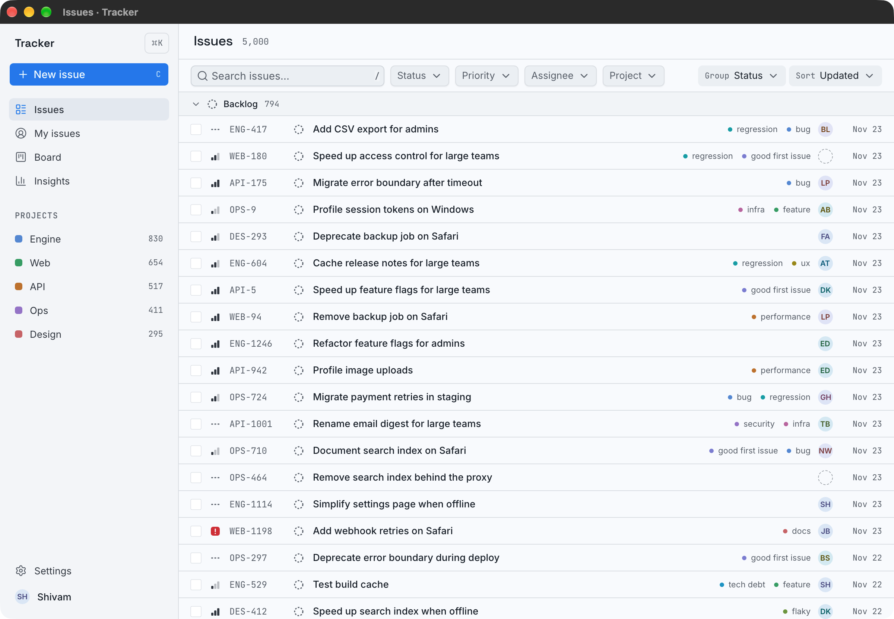

# sepal

**Native Svelte apps, drawn by Blitz.**

[Sepal](https://github.com/etherCorps/sepal): Svelte apps in a native window, without
a webview and without Node at run time. Svelte components are compiled with
Svelte's custom renderer API and drive [Blitz](https://github.com/DioxusLabs/blitz),
a Rust HTML/CSS engine; the JavaScript runs in an embedded QuickJS.

An alpha, on macOS (Linux builds and passes its tests headless; its window has
not been tried yet). Svelte 5 and Tailwind v4 as on the web, pages as files
run by SvelteKit's router, shadcn-svelte components through an opt-in
DOM layer, desktop APIs behind permissions, macOS `.app` bundles and
self-update, and no frame loop: an idle app does no work.



The Tracker example with 1,000 issues, on an Apple M4 Pro (medians of three
runs; [how they were measured](https://github.com/etherCorps/sepal/blob/main/compare/results/compare.md)):

| | |
|---|---|
| Idle CPU, 1,000 issues | 4 ms of CPU time in 20 s, 0.02% of a core |
| Idle memory, 1,000 issues | 107 MB RAM, 43 MB GPU memory |
| Memory after wheel-scrolling the whole list, 1,000 issues | 305 MB RAM, 220 MB GPU memory |

This one package is the runtime, the Vite presets and the `sepal` command; the
prebuilt host comes with it. Start a project with the starter rather than by
installing it directly:

```sh
pnpm create sepal my-app
```

What is in here:

| Import | |
|---|---|
| `sepal` | `mount`, `unmount` |
| `sepal/fs`, `sepal/dialog`, `sepal/clipboard`, `sepal/shell`, `sepal/window` | desktop APIs, each behind a permission in `sepal.config.ts` |
| `sepal/updater` | self-update |
| `sepal/dom` | a small DOM for component libraries written for the web (`dom: true`) |
| `sepal/renderer`, `sepal/protocol` | what the Vite preset and the host are built against |
| `sepal/vite` | the Vite preset for apps without routes, `sepal()`, and `defineConfig` for `sepal.config.ts` |
| `sepal/sveltekit` | `sepalKit()`, for apps with pages in `src/routes`: it takes the place of both `sveltekit()` and the adapter |

The preset compiles Svelte for the Blitz renderer, writes the one `app.js` and
`app.css` the host loads, reads `sepal.config.ts`, and in `vite build --watch`
opens the app and reloads it on save.

```ts
// vite.config.ts
import { sepal } from 'sepal/vite';
export default { plugins: [sepal()] };
```

```ts
// sepal.config.ts
import { defineConfig } from 'sepal/vite';
export default defineConfig({ app: { name: 'My App' } });
```

The `sepal` command runs, bundles and screenshots a built app:

```
sepal run [dist]                          open the built app in a window
sepal bundle [dist] [out-dir] [--sign <identity>] [--notarize <keychain-profile>]
             [--update-key <private-key-file>] [--update-notes <text>]
                                          build a macOS .app; with a key, also the signed update
sepal signer generate <private-key-file>  make the key pair updates are signed with
sepal screenshot <out.png> [dist] [WIDTHxHEIGHT]
```

Building is Vite's job: `vite build`, and `vite build --watch` for dev.
`fetch`, `console` and timers are globals. Everything else is in the
[documentation](https://github.com/etherCorps/sepal#readme).

MIT
